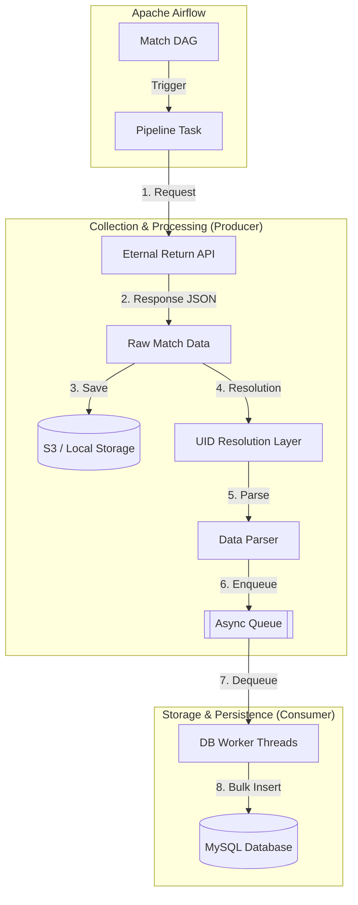
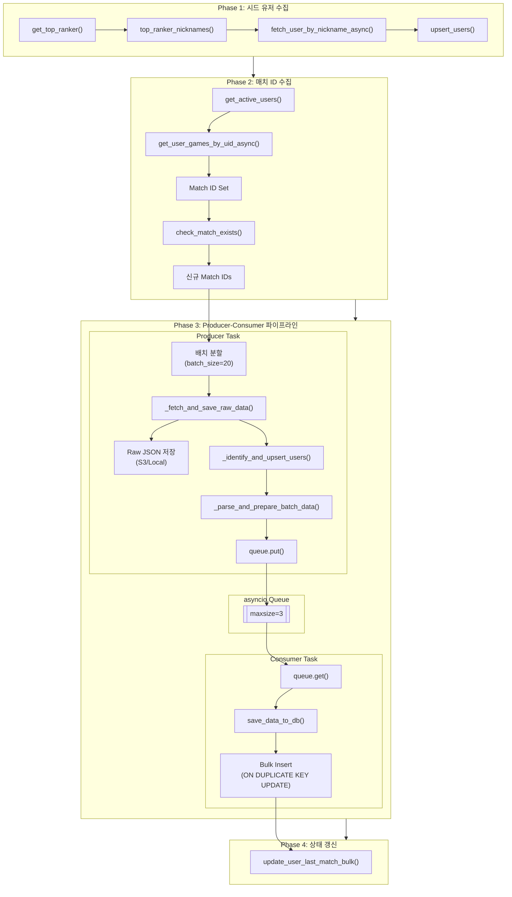

# Eternal Return Data Pipeline (ER-Pipeline)

이터널 리턴 공식 Open API의 매치 데이터를 수집·정제해 MySQL에 적재하는 비동기 ETL 파이프라인

**ER-Pipeline**은 님블뉴런의 '이터널 리턴(Eternal Return)' 공식 Open API로 매치 데이터를 수집해 분석에 쓸 수 있는 형태로 가공·적재한다. `asyncio` 기반 Producer-Consumer 구조로 수집과 적재를 분리해 처리량을 높였고, Apache Airflow로 수집부터 검증까지 자동화했다. 환경 변수(`ENV`)만 바꾸면 로컬 개발 환경과 AWS 운영 환경을 오갈 수 있다.

## 주요 특징

- **비동기 수집**: `asyncio`와 `aiohttp`로 네트워크 대기 시간을 줄이고 동시에 많은 요청을 처리한다.
- **수집과 적재 분리**: `asyncio.Queue`를 사이에 둔 Producer-Consumer 패턴으로 API 수집과 DB 적재가 서로를 기다리지 않게 했다.
- **낮은 메모리 사용**: Pandas DataFrame 없이 Python 기본 `List[Dict]`와 SQLAlchemy Bulk Insert로 처리한다.
- **UID 검증 계층(Resolution Layer)**: API 정책 변경(`userNum` 폐지)에 맞춰 닉네임으로 UID를 먼저 조회하고 내부 식별자(`user_num`)로 매핑한다.
- **모델 기준 스키마**: `models.py`를 스키마의 단일 기준으로 삼아, 컨테이너가 시작될 때 DB 스키마를 모델에 맞게 자동 초기화한다.
- **배치 크기 제한**: 1회 실행에서 처리할 유저 수를 `USER_BATCH_LIMIT`으로 제한하고 연속 스케줄링으로 나눠 처리해 타임아웃을 막는다.
- **환경 전환**: `ENV` 설정만으로 로컬(파일 시스템·Docker MySQL)과 클라우드(AWS S3·RDS)를 전환한다.
- **이원화된 DAG**: 실시간 매치 수집(`match_dag`, 5분 주기)과 정적 메타데이터 갱신(`hash_dag`, Daily)을 분리해 운영한다.

## 기술 스택

| 구분 | 기술 | 용도 |
| --- | --- | --- |
| Language | Python 3.10+ | Type Hinting, Asyncio |
| Orchestration | Apache Airflow 2.x | 워크플로 관리, 스케줄링 |
| Database | MySQL 8.0 | 메인 데이터 웨어하우스 |
| ORM | SQLAlchemy (Async) | DB 추상화, 스키마 관리 |
| Migration | Alembic | 스키마 버전 관리 |
| Container | Docker & Compose | 인프라 코드화 |
| Cloud (Ops) | AWS (EC2, S3, RDS) | 운영 환경 |
| CI/CD | GitHub Actions | 자동 테스트·배포 |

## 빠른 시작

### 사전 요구 사항

- Docker 및 Docker Compose (Docker Desktop에 포함)
- Git
- Eternal Return API Key (개발자 포털에서 발급)
- CLI 모드를 쓸 경우 Python 3.10+와 Poetry

### 환경 설정

프로젝트 루트에 `.env` 파일을 만들고 아래 내용을 입력한다. AWS 관련 값은 GitHub Settings의 Actions secrets and variables에도 등록한다.

```ini
# [필수] API Key
API_KEY="YOUR_API_KEY_HERE"

# [환경 설정] dev: 로컬 / prod: 클라우드
ENV="dev"

# [Airflow 설정]
AIRFLOW_UID=50000

# [데이터베이스 설정 - 로컬/도커 내부 통신용]
DB_HOST="erdb"
DB_PORT=3306
DB_NAME="erdb"
DB_USER="root"
DB_PASSWORD="password"

# [파이프라인 튜닝]
USER_BATCH_LIMIT=30000    # 1회 실행 시 처리할 최대 유저 수
DB_MAX_WORKERS=8          # DB 적재 병렬 워커 수

# [AWS 설정 - ENV=prod 일 경우 필수]
# AWS_ACCESS_KEY_ID=...
# AWS_SECRET_ACCESS_KEY=...
# AWS_S3_BUCKET=...
```

### 실행

#### 로컬 개발 환경 (Docker)

MySQL과 Airflow를 로컬 컨테이너로 실행한다.

```bash
# 컨테이너 빌드 및 실행 (로컬 설정 적용)
docker compose -f docker-compose.yml -f docker-compose.local.yml up -d --build
```

- 컨테이너가 시작되면 `scripts/init_db.py`가 자동으로 실행되어 테이블을 만들고 Alembic 버전을 동기화(stamping)한다.
- Airflow Web UI: [http://localhost:8080](http://localhost:8080) (ID/PW: `airflow` / `airflow`)
- MySQL (호스트): `localhost:3307` (컨테이너 내부 3306 포트로 포워딩)

#### 클라우드·운영 환경

외부 관리형 DB(RDS)와 S3를 사용하며 로컬 DB 컨테이너는 실행하지 않는다.

```bash
# 기본 설정만 사용하여 실행
docker compose up -d --build
```

`.env`의 `ENV`를 `prod`로 설정하고 AWS 관련 변수를 반드시 넣어야 한다.

#### CLI 모드 (테스트용)

Airflow 없이 개별 파이프라인을 실행해 볼 수 있다.

```bash
# 의존성 설치
poetry install

# 정적 데이터 수집 실행
poetry run python scripts/main.py hash

# 매치 데이터 수집 실행
poetry run python scripts/main.py match
```

## Airflow 사용법

Web UI([http://localhost:8080](http://localhost:8080))에서 DAG를 제어한다.

1. **DAG 활성화(Unpause)**: 왼쪽의 OFF/ON 토글을 눌러 파란색(ON)으로 바꾼다.
   - `eternal_return_hash_v1`: 정적 메타데이터 수집. 최초 1회 실행을 권장한다.
   - `eternal_return_match_v1`: 매치 데이터 수집.
2. **실행(Trigger)**: 오른쪽 **Actions** 열의 `▶` 버튼으로 즉시 실행할 수 있다.
   - `match_dag`는 설정된 주기(기본 5분)마다 자동 실행되며, 이전 작업이 끝나지 않았으면 건너뛴다(skip).

## 아키텍처



1. **Orchestration**: Airflow DAG가 설정된 주기(5분/Daily)에 파이프라인 태스크를 실행한다.
2. **Collection (Producer)**:
   - API에서 매치 데이터를 비동기로 수집한다.
   - 원본(Raw JSON)은 유실을 막기 위해 데이터 레이크(S3/Local)에 바로 저장한다.
   - Resolution Layer가 닉네임으로 UID를 검증하고 내부 식별자를 붙인다.
   - 파서(Parser)가 데이터를 정규화해 `List[Dict]`로 변환한 뒤 큐(Queue)에 넣는다.
3. **Persistence (Consumer)**: 컨슈머 워커가 큐에서 데이터를 꺼내 SQLAlchemy Bulk Insert로 DB에 적재한다.

<details>
<summary>상세 데이터 흐름도</summary>



</details>

### 모듈별 역할

| 모듈 | 역할 | 주요 함수 |
|------|------|----------|
| `main.py` | CLI 진입점, 프로세스 분기 | `run_full_process()`, `run_hash_process()` |
| `pipeline.py` | Producer-Consumer 오케스트레이션 | `run_pipeline()`, `produce_batches()`, `consume_batches()` |
| `crawler.py` | 비동기 API 클라이언트 | `ERAPIClient`, `_fetch_json()`, `get_match_infos_async()` |
| `db_utils.py` | DB CRUD 및 캐싱 | `save_data_to_db()`, `upsert_users()`, `check_match_exists()` |
| `match_info_parsing.py` | 매치 데이터 파싱 (Wide/Long Format) | `parse_match_data()`, `_parse_*_from_game()` |
| `hash_info_parsing.py` | 메타데이터 파싱 | `parse_all_meta_files()`, `parse_character_info()` |
| `storage.py` | 저장소 추상화 (Strategy 패턴) | `LocalStorage`, `S3Storage`, `get_storage()` |
| `models.py` | SQLAlchemy ORM 모델 | 테이블 정의 |

## 프로젝트 구조

```text
eternal_return_crawler/
├── .github/                  # CI/CD 워크플로
├── alembic/                  # DB 마이그레이션 스크립트
├── config/                   # API URL 및 설정 파일
├── dags/                     # Airflow DAG 정의
│   ├── match_dag.py          # 매치 데이터 수집 (5분 주기)
│   └── hash_dag.py           # 정적 메타데이터 갱신 (Daily)
├── docs/                     # 데이터 카탈로그·명세서·흐름도
├── scripts/                  # 핵심 로직
│   ├── main.py               # CLI 진입점
│   ├── init_db.py            # DB 초기화, Alembic 버전 동기화
│   ├── pipeline.py           # Producer-Consumer 오케스트레이션
│   ├── crawler.py            # 비동기 API 클라이언트
│   ├── models.py             # SQLAlchemy DB 모델
│   ├── db_utils.py           # DB 세션·쿼리 유틸리티
│   ├── storage.py            # 저장소 추상화 (Local/S3)
│   ├── match_info_parsing.py # 매치 데이터 파싱·정제
│   └── hash_info_parsing.py  # 메타데이터 파싱
├── docker-compose.yml        # 기본(운영) 인프라 정의
├── docker-compose.local.yml  # 로컬 개발용 오버라이드
├── Dockerfile                # 애플리케이션 이미지
├── pyproject.toml            # 의존성 관리 (Poetry)
└── README.md
```

## DB 마이그레이션 (Alembic)

스키마를 바꿀 때는 SQL을 직접 수정하지 않고 Alembic을 사용한다.

```bash
# 1. 모델(models.py) 수정

# 2. 마이그레이션 파일 생성 (컨테이너 내부에서 실행 권장)
docker compose exec airflow-scheduler poetry run alembic revision --autogenerate -m "변경내용_요약"

# 3. 변경 사항 DB 반영
docker compose exec airflow-scheduler poetry run alembic upgrade head
```

> **주의**: `autogenerate`는 완벽하지 않으므로 생성된 리비전 파일을 반드시 검토해야 한다.

## 문서

| 문서 | 설명 |
|------|------|
| [데이터 카탈로그](docs/data_statement/data_catalog.md) | 전체 데이터 자산 목록, 용어 사전, 데이터 계보, 품질 규칙, 분석 시나리오 가이드 |
| [데이터 명세서](docs/data_statement/data_specification.md) | ERD + 32개 테이블 전체 컬럼 명세, API 매핑표 |
| [데이터 흐름도](docs/data_statement/data_flow_diagram.md) | 시스템 아키텍처, 파이프라인 흐름, 함수 레퍼런스 |

## 문제 해결

**"localhost에서 연결을 거부했습니다" (Connection Refused)**
- 로컬에서 DB에 접속할 때 포트가 **3307**인지 확인한다. 3306은 컨테이너 내부 포트다.
- 컨테이너가 `starting` 상태인지 확인한다(`docker ps`).

**Alembic 실행 시 `Table not found` 또는 빈 파일 생성**
- 복합 키나 특수 제약 조건은 `autogenerate`가 감지하지 못할 수 있다. [Engineering Guide] Alembic Manual 문서를 참고해 수동으로 작성한다.

**Airflow Task Timeout**
- 데이터가 급증해 타임아웃이 났을 수 있다. `config.py`의 `USER_BATCH_LIMIT`를 조절하거나 `match_dag.py`의 타임아웃 설정을 확인한다.
